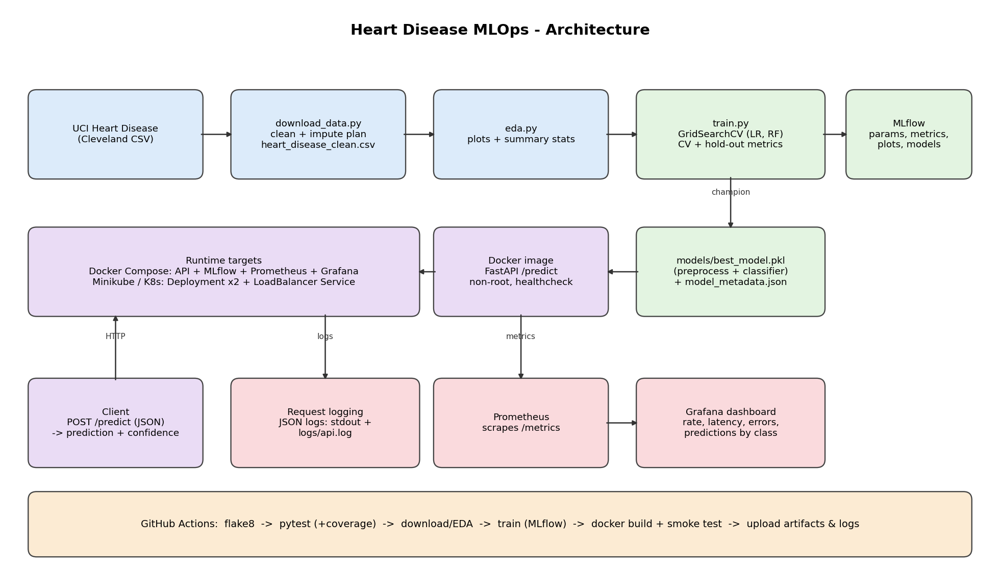

# Heart Disease Prediction - End-to-End MLOps Pipeline

Predicts heart-disease risk from the UCI Heart Disease (Cleveland) dataset and serves it as a
logged, monitored, containerised API.
Stack: scikit-learn - MLflow - FastAPI - Docker/Compose - Prometheus/Grafana - GitHub Actions - Minikube.



## Ports

| Service | URL | Notes |
|---|---|---|
| Prediction API | http://localhost:8000 (`/docs`, `/predict`, `/health`, `/model-info`, `/metrics`) | FastAPI / uvicorn |
| MLflow UI | http://localhost:5000 | experiment tracking |
| Prometheus | http://localhost:9090 | scrapes `api:8000/metrics` |
| Grafana | http://localhost:3000 (admin / admin) | dashboard auto-provisioned |

## Repository layout

```text
.
├── .github/workflows/ci.yml     lint -> tests -> data/EDA -> train -> docker build + smoke test (+ artifacts)
├── Dockerfile                   lean, non-root serving image with HEALTHCHECK
├── docker-compose.yml           MLflow, API, Prometheus, Grafana (healthchecks, provisioned dashboard)
├── initial_deploy.sh            one-command (re)deployment on local Ubuntu/Debian
├── requirements.txt             full env (train + test + lint)   | requirements-serve.txt = serving only
├── pytest.ini / .flake8         test + lint configuration
├── data/                        heart_disease.csv (raw), heart_disease_clean.csv, eda_plots/
├── src/
│   ├── config.py                paths, columns, constants, MLflow URI default
│   ├── download_data.py         download (2 mirrors + offline fallback) and build cleaned CSV
│   ├── data_processing.py       cleaning, validation, sklearn preprocessing pipeline
│   ├── eda.py                   class balance, histograms, boxplots, categorical, heatmap, missing values
│   ├── train.py                 GridSearchCV for LR + RF, CV + hold-out metrics, MLflow logging
│   ├── inference.py             standalone prediction check
│   └── app.py                   FastAPI app: validation, request logging, Prometheus metrics
├── test/                        pytest suite (36 tests, ~93 % coverage of src/)
├── models/                      best_model.pkl (full pipeline) + model_metadata.json
├── k8s/                         deployment.yaml (Deployment + LoadBalancer), ingress.yaml, mlflow.yaml (optional)
├── monitoring/                  prometheus.yml, grafana_dashboard.json, grafana/provisioning/
├── scripts/                     smoke_test.sh, make_architecture_diagram.py
├── docs/                        architecture.png, model_plots/, metrics.json, AUDIT.md
└── screenshots/                 evidence checklist for the report
```

## Redeploy on your local Linux system

### Option A - one command (Ubuntu/Debian)

```bash
cd mlops-heart-disease
chmod +x initial_deploy.sh scripts/smoke_test.sh
./initial_deploy.sh                 # add --with-k8s for Minikube, --reset for a clean slate
```

What it does: installs Docker/Python tooling (skip with `--skip-install`), creates `.venv`, installs
`requirements.txt`, **runs flake8 + pytest (aborts on failure)**, downloads/cleans data, generates EDA plots,
starts MLflow, trains and tracks both models, builds the API image, starts the whole stack and runs
`scripts/smoke_test.sh`.
If Docker was just installed, the script falls back to `sudo docker`; log out/in once to use Docker without sudo.

### Option B - manual steps

```bash
# 0. stop/clean any previous deployment (add -v to also drop MLflow/Grafana data)
docker compose down

# 1. environment (Python 3.12 recommended; >= 3.10 works)
python3 -m venv .venv && source .venv/bin/activate
pip install --upgrade pip && pip install -r requirements.txt

# 2. quality gate
flake8 . && pytest

# 3. data + EDA
python -m src.download_data          # raw + cleaned CSV (falls back to local copy if UCI is unreachable)
python -m src.eda                    # plots in data/eda_plots/

# 4. tracking server, then training (logs to http://localhost:5000)
docker compose up -d mlflow
export MLFLOW_TRACKING_URI=http://localhost:5000
python -m src.train                  # --fast for tiny grids; unset the variable to log to ./mlruns instead
python -m src.inference              # optional local check

# 5. API + monitoring stack
docker compose up -d --build
docker compose ps                    # api and mlflow should be "healthy"
scripts/smoke_test.sh                # health, predict, validation, metrics

# 6. sample request
curl -s -X POST http://localhost:8000/predict -H 'Content-Type: application/json' -d '{
  "age": 63, "sex": 1, "cp": 1, "trestbps": 145, "chol": 233, "fbs": 1, "restecg": 2,
  "thalach": 150, "exang": 0, "oldpeak": 2.3, "slope": 3, "ca": 0, "thal": 6}'
```

Example response:

```json
{"prediction":0,"disease_risk":"Low Risk","probability_disease":0.1655,"confidence":0.8345,"model_name":"Logistic_Regression"}
```

`confidence` is the probability of the *predicted* class; `probability_disease` is P(disease).

### Kubernetes (Minikube)

```bash
minikube start --driver=docker
docker build -t heart-disease-api:v1 .          # requires models/best_model.pkl (run training first)
minikube image load heart-disease-api:v1
kubectl apply -f k8s/deployment.yaml
kubectl rollout status deployment/heart-disease-api
kubectl get pods,svc
minikube service heart-disease-service --url     # prints the URL (or run `minikube tunnel` for an external IP)
scripts/smoke_test.sh "$(minikube service heart-disease-service --url | head -1)"

# optional Ingress
minikube addons enable ingress && kubectl apply -f k8s/ingress.yaml
curl -H 'Host: heart.local' http://$(minikube ip)/health
```

After retraining, rebuild + reload the image and `kubectl rollout restart deployment/heart-disease-api`.

## Modelling summary

* **Data**: 303 rows, 13 features; binary target = (num > 0). `ca` and `thal` have 6 missing cells; they are
  imputed *inside* the pipeline (median for numeric, mode for categorical) so the test fold never leaks statistics.
* **Features**: numeric `age, trestbps, chol, thalach, oldpeak` -> impute + StandardScaler;
  categorical `sex, cp, fbs, restecg, exang, slope, ca, thal` -> impute + one-hot (`handle_unknown="ignore"`).
* **Models and tuning**: Logistic Regression (C in 0.01-10) and Random Forest (trees, depth, leaf size), each tuned by
  stratified 5-fold `GridSearchCV` scored on ROC-AUC while also recording accuracy, precision, recall.
* **Selection**: highest cross-validated ROC-AUC on the 80 % training split; the 20 % stratified hold-out is
  reported only (no selection leakage). Latest run: champion Logistic Regression, CV AUC 0.903,
  hold-out AUC 0.967 / accuracy 0.885 / precision 0.839 / recall 0.929 (see `docs/metrics.json`).
* **MLflow** logs per run: tuned params, CV and test metrics, ROC curve, confusion matrix, feature importance,
  classification report, full CV grid (CSV), model with signature + input example; the champion run is tagged
  `champion=true` and also stores `best_model.pkl` + `model_metadata.json`.
* **Reproducibility**: fixed seeds, pinned `requirements.txt`, the whole preprocessing + classifier is one pickled
  sklearn `Pipeline`, metadata records sklearn/python versions.

## Monitoring and logging

* Every request is logged as a JSON line (request id, method, path, status, latency); predictions also log inputs
  and outputs. Output goes to stdout (`docker compose logs api`) and `logs/api.log` (volume `api_logs`).
  Input values are logged for traceability in this teaching setup - drop that field for real patient data.
* `/metrics` exposes HTTP metrics plus `heart_predictions_total{outcome}`, `heart_prediction_probability`,
  `heart_inference_seconds`, `heart_predict_errors_total`.
* Grafana ships with the datasource and the "Heart Disease Model Monitoring" dashboard already provisioned.

## CI/CD (GitHub Actions)

`lint-test-train`: flake8 (hard fail) -> pytest with JUnit + coverage -> download data -> EDA -> train
(file-based MLflow, no server needed) -> metrics in the job summary -> upload `models/`, `mlruns/`, `reports/`,
plots as artifacts.
`docker-build-test` (needs the first job): builds the image, runs it, executes `scripts/smoke_test.sh`, uploads
container + smoke-test logs. Any failing step fails the workflow.

## Testing locally

```bash
flake8 .
pytest --cov=src
```

Tests are network-free (synthetic data, tiny grids) and cover cleaning, preprocessing, training/MLflow logging,
model persistence, the API contract (valid/invalid input, 503 without model, metrics, request logging) and download fallbacks.

## Troubleshooting

| Symptom | Fix |
|---|---|
| `permission denied ... docker.sock` | log out/in after install, or run via `sudo` (the script falls back automatically) |
| `MLflow server ... is not reachable` | `docker compose up -d mlflow`, or `unset MLFLOW_TRACKING_URI` to log to `./mlruns` |
| Port already in use (5000/8000/9090/3000) | stop the other process or `docker compose down` first |
| `COPY models/` fails at build | run `python -m src.train` before `docker build` |
| UCI download blocked | the script reuses `data/heart_disease.csv`; or download `processed.cleveland.data` manually |
| `minikube service` hangs / no external IP | use the printed NodePort URL or run `minikube tunnel` |

## Submission checklist

- [ ] push to GitHub and add the repo link here: `<REPO URL>`
- [ ] screenshots in `screenshots/` (see the table in `screenshots/README.md`)
- [ ] 10-page report (setup, EDA/modelling, tracking, architecture, CI/CD + deployment screenshots, repo link)
- [ ] short screen recording of the pipeline (`./initial_deploy.sh`, MLflow, `/predict`, Grafana, Actions run)
